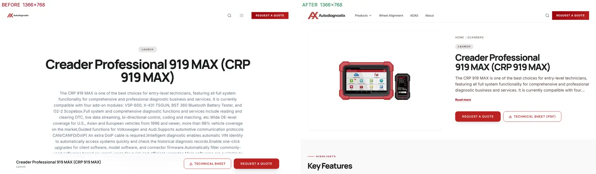
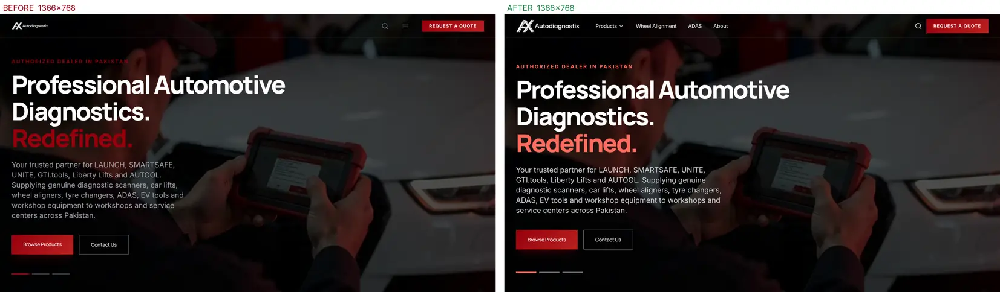
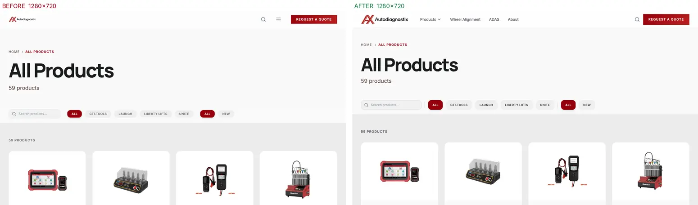
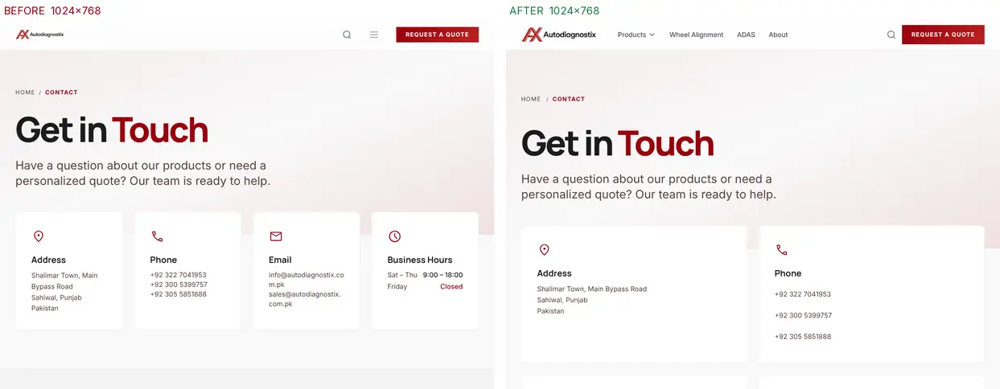
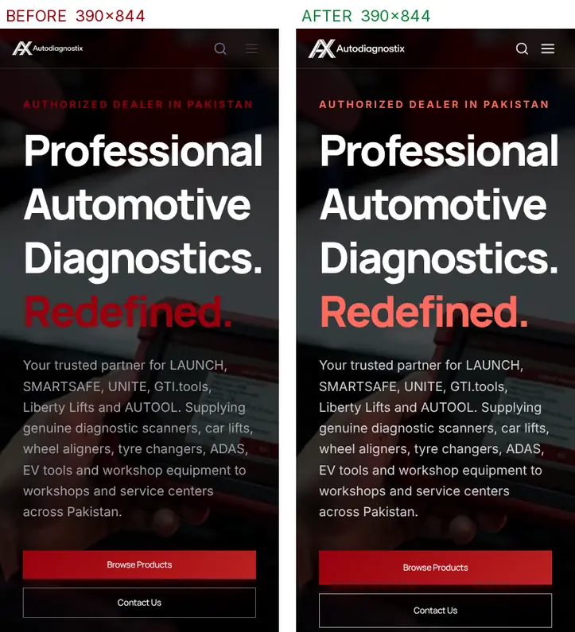
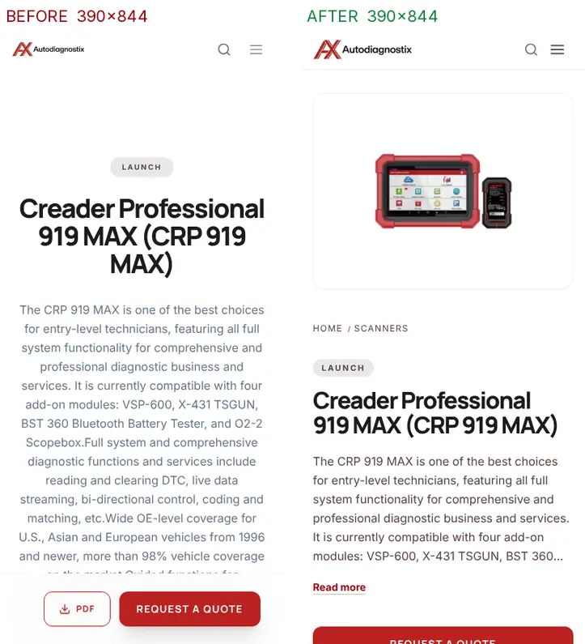

# Responsive pass and QA fixes: results

Date: 2026-11-04. Branch: `claude/loving-hamilton-mu5i92`.

**Status:** implemented and verified locally against the live public CMS. **Not deployed.** The live site changes only after this branch is merged and deployed through the existing Coolify pipeline.

The audit that produced the issue IDs (C1–C4, H1–H9, M1–M17, L1–L5, Q1–Q7) is in [2026-11-04-responsive-qa-audit.md](2026-11-04-responsive-qa-audit.md).

## Results at a glance

| Check | Before | After |
|---|---|---|
| Contact form | Every submission lost (no `/api/contact` route; live 404) | Validated form, success and error states, hand-off to the business inbox (see Q1) |
| Mobile Lighthouse, Performance (7 key pages) | 90–99 compressed local; 55 live on `/contact` | **98–100** |
| Lighthouse Accessibility | 91–96 | **100** on all 7 pages |
| Largest download on icon pages | 3.9 MB icon font | 3.4 KB subset |
| Homepage feature images | 8 MB of PNG | about 100 KB AVIF on desktop |
| Product PDF | 16–76 s, intermittent 500 | 2.3 s first, 5 ms cached |
| Server response time (warm) | 0.25–0.8 s | 0.004–0.04 s |
| Laptop nav (1024–1439 px) | Hamburger only | Products menu plus pillar links |
| Product page at 1366×768 | No image above the fold | Image, title, summary and both actions above the fold |
| Final sweep: 99 URLs × 11 viewports (1,089 loads) | — | 0 overflow, 0 console errors, 0 non-200, 0 heading skips, 0 missing alt, 0 unnamed controls, 0 sub-44 px mobile targets |

## Lighthouse before and after

Lighthouse 12, Chromium headless, default simulated throttling. Seven representative pages (home, products, a product, a category, contact, about, a pillar page). Each cell is Performance / Accessibility. Best Practices was 100 in every run.

### Main comparison: local, production-like

This is the same machine, the same live CMS data and the same network for both columns. A compressing proxy stands in for Cloudflare's compression, because the Node server sends HTML, CSS and JS uncompressed. "Before" is a frozen build of the starting commit (`f0a08bb`).

| Page | Mobile before | Mobile after | Desktop before | Desktop after | Mobile LCP before → after | CLS (worst) before → after |
|---|---|---|---|---|---|---|
| `/` | 95 / 95 | **99 / 100** | 98 / 95 | **100 / 100** | 2.7 → 2.0 s | 0.006 → 0 |
| `/products` | 90 / 94 | **98 / 100** | 96 / 94 | **100 / 100** | 3.0 → 1.9 s | 0.001 → 0 |
| `/product/x-431-pro3-link` | 99 / 96 | **99 / 100** | 96 / 96 | **100 / 100** | 1.7 → 2.1 s | 0.019 → 0 |
| `/category/scanners` | 99 / 95 | **98 / 100** | 99 / 95 | **100 / 100** | 1.7 → 2.3 s | 0.015 → 0 |
| `/contact` | 99 / 92 | **100 / 100** | 99 / 92 | **100 / 100** | 1.7 → 1.7 s | 0.001 → 0 |
| `/about` | 99 / 95 | **100 / 100** | 99 / 95 | **100 / 100** | 1.7 → 1.7 s | 0.009 → 0.007 |
| `/car-lifts-in-pakistan` | 96 / 91 | **99 / 100** | 92 / 91 | **100 / 100** | 1.7 → 2.1 s | **0.152 → 0** |

SEO scores 100 locally in both columns. On the live domain it is 92: Cloudflare's managed `robots.txt` adds a `Content-Signal` line that Lighthouse does not recognise. This is an edge setting and is not in this repository (L5).

The simulated LCP rose by 0.4–0.6 s on three pages, while first paint got 0.5–0.7 s earlier:

- Before, render-blocking Google Fonts CSS delayed the first paint until the web font was available.
- Now, text paints immediately in the fallback font and is repainted when the preloaded self-hosted font arrives. Lighthouse counts that repaint as LCP.
- All values stay inside the "good" threshold (under 2.5 s).
- `font-display: optional` would remove the repaint, but first-time visitors on slow connections would then see the fallback font for that page view. I left this as a design choice (see Recommendations).

### Live site baseline (before, as currently deployed)

| Page | Mobile | Desktop | Mobile LCP |
|---|---|---|---|
| `/` | 82 / 95 | 97 / 91 | 3.4 s |
| `/products` | 85 / 94 | 94 / 90 | 3.8 s |
| `/product/x-431-pro3-link` | 97 / 95 | 98 / 91 | 2.1 s |
| `/category/scanners` | 98 / 93 | 96 / 88 | 1.8 s |
| `/contact` | **55** / 92 | 98 / 92 | **22.6 s** |
| `/car-lifts-in-pakistan` | 96 / 91 | 96 / 87 | 2.1 s |
| `/about` | 93 / 95 | 98 / 90 | 2.0 s |
| `/brands` | 91 / 95 | 89 / 90 | 1.8 s |

Live results vary between runs in this environment because traffic passes through an outbound proxy. The 3.9 MB icon font produced a 22–23 s mobile LCP in two of three runs (live `/contact` and local `/about`), but not in the compressed comparison run, depending on whether the simulation placed it on the critical path. Re-run PageSpeed Insights after deployment for authoritative live numbers.

## Fixes by area

### Contact and lead flow (C1)

- **The contact form no longer loses enquiries.** It validates inline with accessible messages (`aria-invalid`, `aria-describedby`, an error summary, and focus moved to the first invalid field). It then opens the visitor's email app with a formatted message to `info@autodiagnostix.com.pk` (cc `sales@`).
- After submitting, a success state offers **Copy message**, **Call** and **Edit message**. Without JavaScript, the form falls back to a `mailto:` action.
- **Product "Request a Quote" buttons pre-fill the form.** The subject is set to "Request a Quote" and the message names the product.
- Inputs are 16 px (no iOS zoom on focus) and 48 px tall, with borders that meet non-text contrast.
- Commit: `1856598`. **Q1 remains open:** choosing a real delivery backend is the owner's decision.

### Performance (C2, C3, C4, H9, M13)

- **Icon font:** the 3.9 MB Material Symbols variable font is now a 3.4 KB subset of the 13 icons in use, self-hosted. A test fails if a new icon is not in the subset. Commits `6894a42`, `5e9a087`.
- **Text fonts:** Inter and Manrope are self-hosted (OFL) and preloaded, removing two render-blocking third-party stylesheets. `scripts/fetch-fonts.mjs` reproduces them. Commit `5e9a087`.
- **Homepage images:** responsive AVIF/WebP (800w and 1600w) replace the 6.1 MB and 1.9 MB PNGs (`scripts/responsive-images.mjs`). Commit `1e68b33`.
- **Product photos:**
  - A new same-origin endpoint `/media/w{320|480|640|960}/uploads/…webp` resizes and converts CMS uploads once with sharp.
  - Results are kept in a 64 MB LRU cache and marked immutable. Requests are validated against allowed widths and upload file names, and any failure redirects to the original image.
  - The 343 KB POWER X PNG becomes 16 KB, and `/products` drops from 1.25 MB to 767 KB.
  - Commits `31bf7d6`, `0308686` (sharp made a runtime dependency).
- **Technical-sheet PDFs:**
  - One reused browser, an hourly cache, shared in-flight renders, a bounded render timeout, and a friendly 503 instead of a raw error.
  - The button shows "Preparing PDF…" and a status message.
  - Commits `ffa1488`, `1b3d933`.
- **CMS response cache:**
  - Fresh for 60 s, then stale-while-revalidate for up to 10 minutes. Failures are never cached, so 404 and 503 behaviour is unchanged.
  - Tunable with `CMS_CACHE_SECONDS` (0 disables it).
  - Commit `d90f1fa`.
- **LCP:**
  - The homepage headline is no longer hidden and re-faded by GSAP at hydration.
  - Islands hydrate on idle, the first catalog image gets `fetchpriority="high"`, and summaries are trimmed at word boundaries instead of sent in full twice.
  - Commit `31bf7d6`.

### Header and navigation (H1, H4, M14)

- From 1024 px, the header shows a **Products** disclosure menu (all CMS categories, All products, All brands) beside the existing Wheel Alignment, ADAS and About links. The inline list of every category cannot fit reliably in the 1536 px container.
- Phones and tablets keep the full-height menu, which uses two columns on tablets. Hover opens the menu for mouse users; click, Escape, outside click and focus return are handled.
- **The logo is legible:** a cropped wordmark replaces an asset that was 62% transparent padding. The original files are kept for the PDF template and schema.
- A skip-to-content link and a `#main-content` landmark are on every page. SVG icon attributes are fixed.
- Commit `463e954`.

### Product pages (H2, M12, M15)

- A two-column hero from 1024 px, with the image first on phones.
- Long summaries clamp with **Read more**, and both actions sit in the hero.
- The fixed action bar slides in only after the hero actions scroll away. It is 64–80 px tall (was 96 px) and no longer contains an `h3`.
- Verified at 1024–2560 px for the six longest product names: both actions are above the fold and the image is in the top half.
- The specifications grid fills each row, gallery controls are 44 px, and a breadcrumb was added.
- Commits `1b3d933`, `3704c66`.

### Homepage (H3, H6, M2, M6, M7, M11)

- **Hero accent text:** the tagline and highlighted word use `#ff6b5e` (5.2:1, up from about 1.6:1). Slide indicators align with the copy and are 44 px targets. One copy measure is used from 768 px up. Commit `d3ee424`.
- **Category strip:** an 8-tile grid (2, 4 or 8 per row) that includes an All Products tile. Nothing is clipped and there are no orphan tiles.
- **Other homepage fixes:**
  - New Arrivals is aligned correctly on mobile.
  - The empty Heavy Duty grid is gone.
  - Client logos sit in full rows.
  - Certification cards are in one row with correct heading levels.
- Commit `096700d`.

### Layout, grids and catalog (M1, M4, M5, M8, M9, L1, L2)

- **Containers:**
  - Every page uses the header's 1536 px container.
  - Wrappers that carry their own gutter use a `max-w-site` (100rem) token.
  - Left edges now align at every width.
- **Grids:**
  - Grids whose item count comes from the CMS pick their column count from that count (`utils/grid.mjs`, with tests): four lifts render as 2×2 or 4×1, not 3+1.
  - Image boxes clip, so cards keep even heights.
- **Cards:** summaries are no longer cut mid-word.
- **Products page:**
  - The filter becomes one horizontally scrollable chip row on phones.
  - The bar sticks only from 768 px up.
  - Chips and search are 44 px.
- **Headers:** catalog page headers are tighter, so products start higher on laptops.
- **Pillar pages:**
  - Unclosed tags fixed on 18 pages.
  - Doubled section padding removed on 11 pages.
  - Intro paragraphs capped at about 75 characters per line.
- **Contact:** info cards switch from four columns to two between 640 and 1279 px, so email addresses no longer break.
- **Brands:**
  - `/brands` now lists all six brands, adding SMARTSAFE and AUTOOL.
  - Cards show logos instead of product photos.
  - Brand pages with no assigned products no longer say "0 products".
- Commits `096700d`, `206197c`, `1faf618`, `e96cb4a`.

### Accessibility (H5, H7, H8, M16, M17)

- **Focus:** brand-red focus rings on light surfaces and white on dark ones. Previously the `currentColor` ring disappeared around white-text buttons.
- **Touch targets:** at least 44 px everywhere on mobile, including:
  - footer links and social icons
  - breadcrumbs
  - contact links
  - filter chips
  - search close
  - FAQ toggles
  - hero controls
- **Contrast fixes:**
  - footer text
  - New Arrivals copy
  - stats labels
  - legal pages
  - badges
  - inactive lift options
  - the "Need expert advice" card
- **Other:**
  - Inline links in pillar intros are underlined (WCAG 1.4.1).
  - Breadcrumbs have accessible names and `aria-current`.
  - Heading order was fixed site-wide.
- Commits `65bc8a5`, `05ce7f7`, `3704c66`.

### SEO (L3)

- A raster 1200×630 `og-image.png` (the existing SVG artwork rendered with the brand font) is now the default social preview. The SVG is kept. Commit `b5b1246`.
- Titles, descriptions, canonicals, sitemap and schema from the previous SEO pass are unchanged. `npm run verify:seo` passes with 0 failures.

## Re-test

| Test | Result |
|---|---|
| Full sweep: 99 URLs × all 11 required viewports (1,089 page loads) | 0 horizontal overflow, 0 console errors, 0 failed requests (after one fix), 0 non-200 except the intentional 404, exactly one H1 everywhere, 0 heading-order skips, 0 missing alt, 0 unnamed controls, 0 targets under 44 px at 360/390/414 px |
| `npm test` (node:test) | 45 tests pass (after the follow-up pass); `npm run typecheck` reports 0 errors. New tests cover the icon subset, grid columns, excerpt, media URL validation and LRU, and the CMS cache |
| `npm run verify:responsive` | 0 failures. Updated for the 64rem nav breakpoint and Products menu |
| `npm run verify:seo` | 0 failures |
| `npm run verify:outage` (unreachable CMS) | 10 routes return retryable 503; contact stays 200; `/media` falls back to the original URL |
| Contact form (Playwright) | Prefill, required and format errors, live re-validation, success state, copy, edit; no page errors |
| PDF | Cold 2.3 s, cached 5 ms, three concurrent requests share one 1.4 s render, unknown product 404, button progress and download verified |
| Above-the-fold product check | Both hero actions visible and image in the top half for 6 products × 7 laptop/desktop sizes |

Screenshots of five templates at all 11 viewports were reviewed manually. Side-by-side evidence:








### Cross-browser

Testing was done in Chromium only; no real Safari, iOS, Firefox or Edge devices were available. Source-level checks:

- **Edge:** uses Chromium.
- **Safari:** backdrop blur has `-webkit-` prefixes, and mask icons were already prefixed.
- **iOS:**
  - Inputs are 16 px, so focusing them does not zoom.
  - `100dvh`/`svh` have `vh` behaviour as the fallback.
  - Safe-area padding is set on the fixed bar.
- **Newer CSS:**
  - `:has()` (product body padding) needs Safari 15.4+ and Firefox 121+; older browsers just lose the extra bottom padding.
  - `text-wrap: balance` is decorative.
  - `<dialog>`, `inert` and `IntersectionObserver` are supported in all current browsers. Without IntersectionObserver, the product action bar stays hidden and the hero actions remain.
- **Recommendation:** a quick manual pass on a real iPhone (Safari) and Firefox before release.

## Follow-up pass: SEO audit and remaining fixes

A second crawl of every sitemap URL checked:
- titles and meta descriptions (length, uniqueness, punctuation)
- canonical and `og:url` agreement
- Open Graph data
- JSON-LD validity
- sitemap coverage against internal links
- redirects
- every internal (218) and external (19) link

| Finding | Fix | Commit |
|---|---|---|
| " , " punctuation artifacts (a dash bulk-replaced) in 18 titles, 2 descriptions, 104 image alt texts, FAQ answers and FAQPage schema, visible copy and a heading (Q4) | Normal ", " (or ": " between a title and subtitle); wording otherwise unchanged | `850eeba` |
| Category titles repeated the category name ("Scanners in Pakistan , Scanners Products & Equipment") | "Scanners in Pakistan: Products & Equipment" | `850eeba` |
| Literal "&amp;" in the EV page's visible FAQ and its schema | Entity removed from the JavaScript string | `850eeba` |
| 72 titles over 60 characters, mostly because " \| Autodiagnostix" was always appended | Suffix added only when it fits (Google already shows the site name); home keeps it. 20 remain, mostly long CMS product names | `3db5e03` |
| Product meta descriptions were the full CMS summary (up to 1,218 characters) | Cut at a word boundary to 158 characters | `3db5e03` |
| `og:image:width/height` claimed 1200×630 on all 59 product pages (about 500 px photos), with the generic site alt text | Dimensions only for the default card; product name as `og:image:alt` | `3db5e03` |
| `/brand/gti-tools` and case variants (`/brand/Launch`) duplicated canonical brand pages; the footer and homepage linked the alias | One-hop 301 to the canonical page; internal links point at `/brand/gtitools` | `3db5e03` |
| TypeScript check failed (4 errors) | Fixed; `npm run typecheck` added | `23d7495` |
| Contact form had no server endpoint (Q1) | `/api/contact` with validation, honeypot, origin check and rate limit; delivers to `CONTACT_WEBHOOK_URL` when set, otherwise unchanged mail-app fallback | `eb43ff6`, `9c960d0` |

Checks that passed with no change needed:
- canonical and `og:url` agree on every page
- all JSON-LD parses, uses www URLs and has the required Product and Breadcrumb fields
- business hours, phone and address in LocalBusiness match the contact page
- sitemap covers every internally linked page, and every sitemap URL is linked
- trailing slashes 301 to the canonical form
- `/admin` is `noindex` and disallowed
- unknown URLs return 404
- no broken internal links

The two external "failures" are bot blocking (Instagram 429, Changan 403) and open normally in a browser.

Lighthouse on the final build (compressed local): `/`, `/contact`, `/product/x-431-pro3-link`, `/category/scanners` and `/brand/gtitools` score 98–100 mobile and 100 desktop, with 100 for Accessibility, Best Practices and SEO.

## Visible design changes to review

These refine rather than redesign. Each was needed to meet a stated requirement and can be adjusted or reverted on request.

1. **Desktop navigation** groups the categories under a **Products** menu, instead of hiding them behind a hamburger on laptops (and crowding them at 1440–1535 px).
2. **Hero accent colour on the dark hero only:** `#ff6b5e`, a lighter tint of the brand red, so it meets WCAG AA. The brand crimson is unchanged everywhere else.
3. **Product page hero** is two columns on laptops and desktops, with a Read more toggle for long summaries.
4. **Homepage hero intro animation removed**; slides still crossfade. The animation hid the main headline at load.
5. **Category strip** is a grid with an extra "All Products" tile; **brand cards** show logos.
6. **Header logo** is visibly larger (same artwork, cropped padding).

## Deployment notes

- **No new services or frameworks.** sharp moved from devDependencies to dependencies at the same locked version. Fonts and images are static files.
- **Optional environment variables** (passed through in `docker-compose.yml`, documented in `astro/.env.example` and `DEPLOYMENT.md`):
  - `CMS_CACHE_SECONDS` (default 60): Strapi edits appear within about a minute; set it to `0` to read live.
  - `CONTACT_WEBHOOK_URL`: enables server-side delivery of enquiries.
- **Cloudflare:**
  - `/media/…webp` responses are `public, max-age=31536000, immutable`, which Cloudflare caches by default for `.webp`. Confirm `cf-cache-status: HIT` after deploying.
  - PDFs are cached in the Node process (one hour). The CDN does not cache them (`/api/` path).
- **Memory:** the in-process caches are bounded at 64 MB (images), about 60 PDFs, and about 500 CMS responses.
- **After deploy:**
  - Re-run PageSpeed Insights.
  - Submit a test enquiry from a phone and a desktop.
  - Download one technical sheet.
  - Share one URL on WhatsApp to confirm the new preview image.

## Remaining issues and recommendations (not done, with reasons)

| Item | Why it was not done | Recommendation |
|---|---|---|
| Contact form delivery destination (Q1) | The endpoint is built; choosing where enquiries go is a business decision | Set `CONTACT_WEBHOOK_URL` in Coolify (for example a Zapier/Make "Webhook → Gmail" zap, or a Google Apps Script that emails info@). No code change needed. Until then the email-app fallback is used. |
| WhatsApp contact (Q2) | No WhatsApp number is published | Provide the WhatsApp Business number; a click-to-chat link or floating button is a small change |
| Hero images are 1024 px (M3) | Higher-resolution sources are not in the repo | Supply at least 1920 px (ideally 2560 px) originals; the same responsive pipeline will serve them |
| Heavy PNGs in Strapi | CMS content was not modified (out of scope; no CMS writes) | `/media` already serves them small; re-uploading as WebP would also shrink the PDF and direct-link sizes |
| Inconsistent stats (Q3), missing CMS brand assignments (Q6) | Business content and CMS data | Owner to confirm the numbers; assign brands in Strapi (this also fills the SMARTSAFE and AUTOOL brand pages) |
| 77 hand-written meta descriptions over 160 characters; 20 titles over 60 (long product names) | Rewriting traffic-bearing copy is a content decision; search engines truncate rather than penalise | Optional copy pass, prioritising pages with impressions in Search Console |
| Lighthouse SEO 92 on the live domain (L5) | Cloudflare-managed `robots.txt` `Content-Signal` line, set at the edge | Owner decision; the content-signal policy may be intentional |
| Text-font repaint counted as LCP | `font-display: optional` would change first-visit typography on slow networks | Keep `swap` (current), or switch to `optional` if lab LCP matters more than first-visit fidelity |
| Map embed (Q7) | Embedding adds about 500 KB of third-party script | Keep the Google Maps link card (current) |
| Real-device cross-browser certification | No device lab available | Manual pass on iPhone Safari and Firefox before release |

The earlier [laptop responsiveness note](../seo/2026-11-04-responsive-favicon-and-catalog-fixes.md) describes a 90rem full-navigation breakpoint; that is superseded by the 64rem Products menu above.

## Reproduce

From `astro/`:

```bash
npm ci
npm test
PUBLIC_STRAPI_URL=https://strapi.autodiagnostix.com.pk npm run build
PUBLIC_STRAPI_URL=https://strapi.autodiagnostix.com.pk PORT=4321 node ./dist/server/entry.mjs
SEO_BASE_URL=http://127.0.0.1:4321 npm run verify:responsive
SEO_BASE_URL=http://127.0.0.1:4321 npm run verify:seo
```

As root inside a container, Chromium also needs `--no-sandbox`. Regenerate assets with `node scripts/fetch-fonts.mjs`, `node scripts/responsive-images.mjs` and `node scripts/render-og-image.cjs`.
