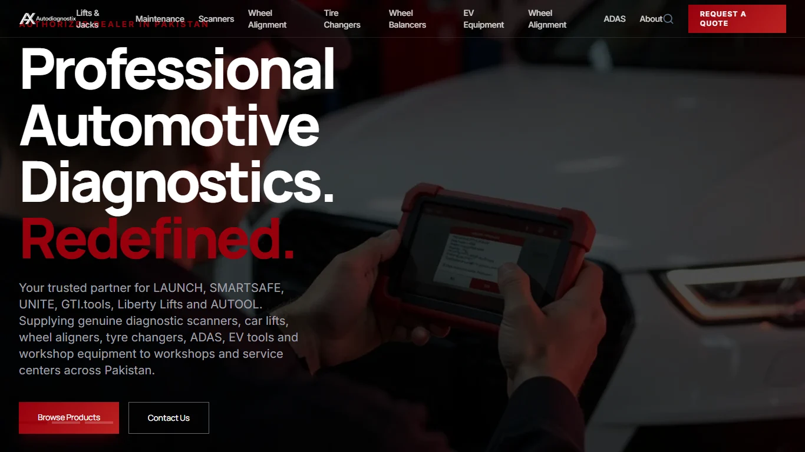
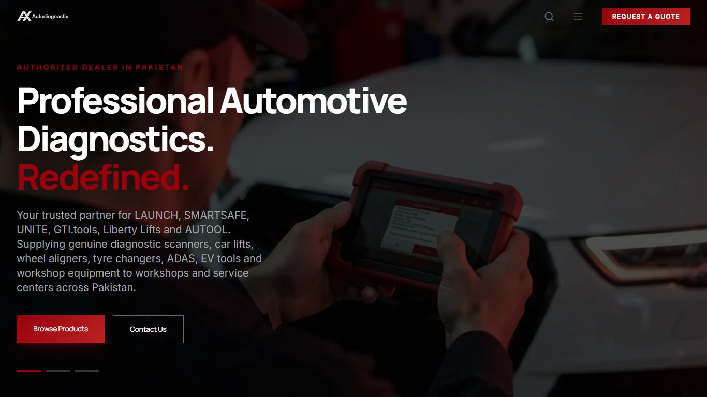

# Laptop responsiveness, favicon restoration and remaining technical SEO fixes

Date: 2026-11-04. Status: **implemented and tested locally; not deployed**.

This follows the approved [technical SEO implementation](implementation-and-validation.md). The user approved a responsive-only pass and requested the remaining safe SEO fixes and restoration of the existing favicon. No redesign, new marketing copy, product URL migration or sister-site work was authorized or performed.

## 1. Laptop responsiveness

### Reproduced defects

At 1366×768 and 1280×720, the desktop navigation wrapped six labels, compressed the header and crowded the search/quote area. The hero used 96px display text at those widths, and its first tagline appeared underneath the fixed header. At 1366×768, the tagline started at 31px while the header ended at 64px. There was no page-wide horizontal overflow, so hiding horizontal overflow would not have fixed the actual issue.

### Changes

- Full navigation is shown from a content-fit breakpoint of 90rem (1440 CSS pixels at the default root size). Smaller laptop/tablet screens use the existing accessible menu rather than wrapping or removing catalog links.
- The quote action remains visible on laptop/tablet screens. Phones retain their existing in-menu quote action.
- Desktop labels and the quote action do not wrap, and the logo/actions retain their intrinsic width.
- Header color updates now select navigation links by a stable element ID rather than an escaped responsive-utility selector. Menu breakpoint JavaScript matches the CSS breakpoint.
- Hero display text scales with available viewport width **and height**, reaching the original 96px size at 1920×1080 rather than using that size on every laptop.
- Hero content reserves space for the fixed header and slide controls. Smaller laptops get a wider copy budget within the existing page gutters.
- Narrow phones use overlapping grid slides with intrinsic content height, so longer existing copy can scroll naturally instead of being clipped. All slides share the same row size to avoid a height jump on selection; their backgrounds stretch to fill that row.
- Existing imagery, colors, font families, copy, animations, product data and link destinations are retained. No content was shortened or hidden to fit a test.

Changed UI files: `Header.astro`, `HeroSlideshow.tsx` and scoped responsive rules in `global.css`. The existing error-page layout also supports the transient CMS error state described below.

### Before and after

1366×768, same original imagery and text:

## 2. Favicon restored

Root cause: both AutoDiagnostix clients still shipped the purple framework-default SVG at `/favicon.svg`. The Astro head preferred it even though the approved red AX PNG already existed. Another icon declaration incorrectly labeled a WebP file as `image/png`.

- Rebuilt SVG, multi-frame ICO, 32px/48px PNG and 180px Apple touch icons from the **existing** `astro/public/favicon.png`. This is re-encoding approved artwork, not a new logo.
- Updated Astro icon references with accurate MIME types/sizes and cache-busting on the SVG/ICO URLs.
- Replaced the same default SVG and versioned its reference in the legacy AutoDiagnostix client (`app/`). No other legacy application UI or SEO targeting was changed.
- Organization schema now uses the real full business logo rather than a favicon.
- Added `npm run restore:favicons` to reproduce the assets from the retained source PNG.

All five preferred icon URLs returned 200 with correct MIME types in the final production-build test. The browser/search engine's existing favicon cache will update only after deployment and refresh/recrawl; this task did not change the live website.

## 3. Remaining technical SEO fixes

### Full catalog pagination

The earlier patch paginated the sitemap, but general catalog readers still stopped at 100 products and 50 categories. The shared public CMS client now reads all pages for product/category listings while preserving normalization, product order and existing URLs. Tests exercise 205 products and 57 categories, including incomplete/later-page failure cases.

### CMS outages are not deletions

Previously a transport/API failure became `{data: []}`, resulting in false product/category 404s or apparently empty successful listing pages. The strict client now distinguishes a successful empty result from an unavailable or invalid upstream response.

- A genuine successful lookup with no matching product/category/brand still returns the original 404 state.
- A CMS outage on catalog-dependent pages returns **503**, `Retry-After: 60`, and `Cache-Control: no-store` through narrowly typed Astro middleware.
- The existing error-page layout presents a temporary-unavailability message rather than claiming the product was deleted. Temporary HTML responses carry neither an erroneous canonical nor a noindex instruction for the affected product URL.
- Search/PDF API failures and the sitemap also return retryable 503 responses instead of false not-found/empty-success results.
- CMS-independent contact information remains available with HTTP 200.
- Only typed CMS errors are handled this way; unrelated application errors are not silently hidden as catalog outages. No private upstream URL, transport detail or stack trace is rendered to visitors.
- Concurrent identical CMS reads still share in-flight transport; failed requests are not cached permanently and can recover.

No existing healthy-page title, description, primary keyword targeting or indexation decision was changed. No cross-domain canonical, redirect, new city page, artificial offer, fabricated rating or business-ownership assertion was introduced.

## 4. Validation

| Check | Final result |
|---|---|
| Astro production build | Pass |
| `npm run test:seo` | 30 tests passed |
| `npm run verify:seo` | 73 canonical sitemap destinations; zero failures |
| `npm run verify:responsive` | 10 screen sizes × all three hero slides; zero failures |
| Catalog pages at laptop size | Products, category, brand and product pages fit without page-wide overflow |
| Full desktop navigation | No wrapped labels at tested full-navigation widths |
| Compact menu | Opens, contains catalog links, fits the viewport and closes with Escape |
| Hero | Taglines clear header; actions remain inside hero and do not overlap slide controls |
| Favicon | Branded SVG/ICO/PNG/touch assets served; dimensions and multi-frame ICO checked |
| `npm run verify:outage` | Ten catalog/API/sitemap routes return retryable 503; contact stays 200 |
| Unknown routes with healthy CMS | Genuine 404 behavior retained in SEO integration checks |
| Mechanical design detector | One warning about existing Inter font; intentionally retained to preserve approved branding |
| `git diff --check` | Pass |

Screen sizes checked in Chrome: 320×720, 390×844, 768×1024, 1024×768, 1280×720, 1366×600, 1366×768, 1440×900, 1536×864 and 1920×1080. These are browser-emulated CSS viewports, not a claim of real-device or cross-browser certification.

Representative final measurements:

| Viewport | Hero font | First tagline top | Header bottom | First-slide action bottom |
|---|---:|---:|---:|---:|
| 1280×720 | 64px | 103px | 64px | 633px |
| 1366×768 | 68.3px | 120px | 64px | 664px |
| 1440×900 | 72px | 153px | 64px | 763px |
| 1536×864 | 76.8px | 113px | 64px | 767px |
| 1920×1080 | 96px | 195px | 64px | 901px |

On a 320px-wide phone, the hero grows to about 914px to contain unchanged copy and controls rather than clipping them into a 720px viewport. Users can scroll normally. Short laptop viewports can likewise scroll if their height is below the existing minimum hero height.

The first batched inspection found narrow-phone clipping and a test artifact caused by clicking a below-fold slide control on a short viewport. One correction batch added intrinsic mobile hero sizing and reset the test scroll position before geometry assertions. The final batched confirmation reported no failures. Local full screenshots and metrics are retained in `astro/.tmp/responsive/` (untracked).

The earlier external schema validation remains applicable to the unchanged quote-only Product/BreadcrumbList structure: Schema Markup Validator passed; Google product rich-result eligibility remains unavailable without a real Offer/review/rating. No claim that all external validator limitations have disappeared is made.

## 5. Reproduce tests

From `astro/`, run `npm run test:seo` and `npm run build`. Start the production server with the real public CMS URL, then set `SEO_BASE_URL` and optionally `PUPPETEER_EXECUTABLE_PATH` to run `npm run verify:seo` and `npm run verify:responsive`.

For the isolated failure test only, start another **local** instance with `PUBLIC_STRAPI_URL=http://127.0.0.1:9`, set `CMS_OUTAGE_BASE_URL` to that local instance and run `npm run verify:outage`. The test script refuses non-local targets. Do not configure a production service with the deliberately unreachable test URL.

## 6. Deployment and remaining evidence-dependent work

- No deployment, push, Cloudflare configuration change, CMS write or sister-site modification occurred.
- Deploy the Astro application through the existing process and verify the new favicon URLs/HTML, sitemap and canonical signals on the live host. Clear stale edge responses through the authorized deployment procedure if needed.
- Cloudflare's live robots override still needs an owner-authorized policy check; the origin file cannot force the edge to retain its sitemap reference/private-path exclusions.
- Founding year, map pin, hours, social identities, authorizations, warranty and legal/company relationships still require verified business input. No values were invented or silently retargeted.
- Launch X431 query/page performance and analytics/conversion access are still needed for comparative targeting/lead measurement.
- Field Core Web Vitals measurements remain outstanding; earlier PageSpeed access was quota-blocked. No ranking, traffic, conversion, Core Web Vitals or AI-citation improvement is claimed.
- Follow the baseline report's deployment-date and 7/14/28-day monitoring framework. Existing keyword ownership and sister-site protection rules remain unchanged.
